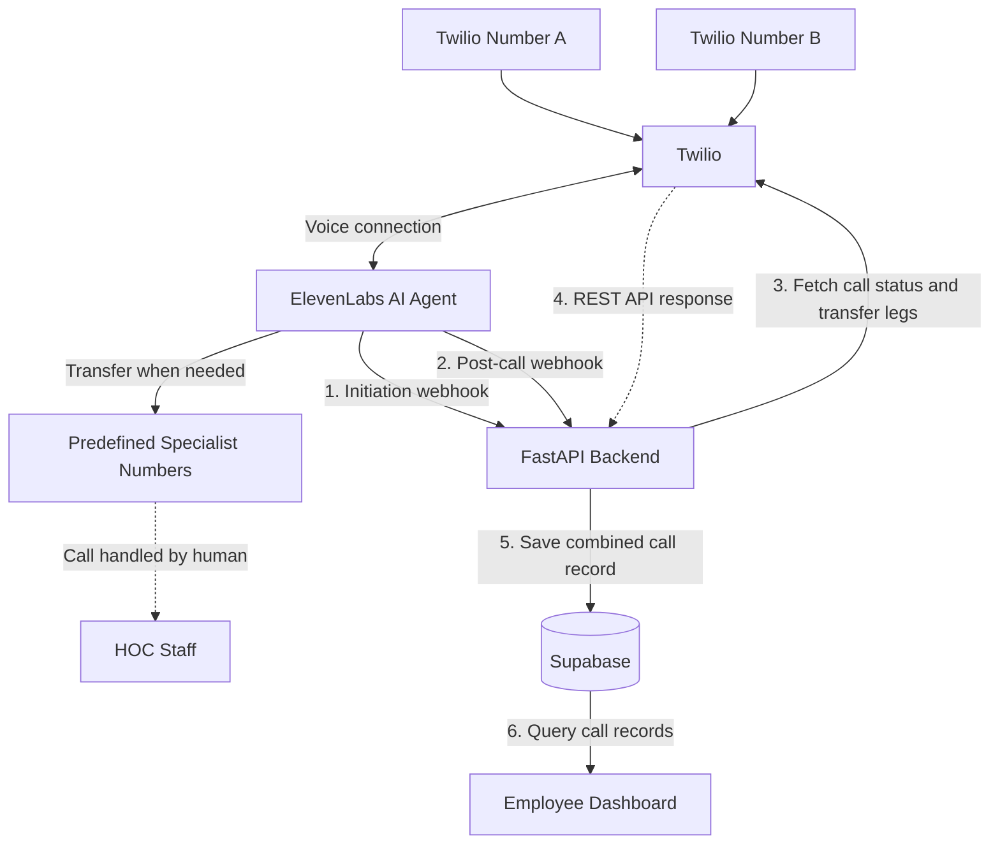

# ADR: HOC Phone System Integration with Twilio and ElevenLabs

## Status

Proposed — pending validation of transfer tracking.

## Context

Avenue Homeownership Center (HOC) wants to replace its existing phone menu with an AI voice agent that can answer questions, collect caller information, and connect callers with appropriate staff.

The system will support two incoming phone numbers, both connected to the same ElevenLabs agent.

For testing, we will use two Twilio numbers. In production, we plan to migrate the existing business numbers to Twilio.

## Decision

We will use the native ElevenLabs–Twilio integration.

- **Twilio:** Receives incoming calls, connects callers to ElevenLabs, and provides call status information.
- **ElevenLabs:** Conducts conversations, identifies caller needs, provides information, and transfers callers to predefined specialist destinations.
- **FastAPI:** Collects ElevenLabs post-call data and retrieves Twilio call records.
- **Supabase:** Stores combined call records for the employee dashboard.

The backend will not participate in live conversations or determine transfer destinations.

## Architecture

### Data Flow

1. **Incoming call:** A caller dials either Twilio number. Twilio connects the call to the same ElevenLabs agent.
2. **Conversation initiation:** ElevenLabs sends an initiation webhook to FastAPI. The backend associates the ElevenLabs conversation ID with the Twilio Call SID.
3. **Conversation and routing:** ElevenLabs handles the caller's request and transfers them to a predefined specialist number when necessary.
4. **Post-call processing:** ElevenLabs sends the transcript, analysis, and conversation metadata to FastAPI after the conversation ends.
5. **Twilio lookup:** FastAPI retrieves the final call status and any available transfer call legs from Twilio.
6. **Storage:** FastAPI combines the provider data and saves it in Supabase.
7. **Dashboard:** The employee dashboard reads the processed call records from Supabase.

The initiation webhook is a request-response interaction; FastAPI returns the expected conversation initialization response. The Twilio lookup is performed after the conversation, with retries if call information is not yet finalized.

## Call Routing

The ElevenLabs agent will identify the caller's needs through natural conversation, without requiring numbered menu selections.

| Caller category | Agent behavior |
|---|---|
| Homebuyer education | Explain free classes, English/Spanish availability, and online registration. Transfer to HOC staff if needed. |
| Buying a home | Transfer to pre-purchase counselors. |
| Mortgage delinquency / foreclosure | Prioritize transfer to a foreclosure counselor. |
| Existing homeowner | Transfer to the intake team. |
| Other Avenue programs | Transfer to Avenue's main line. |
| Services Avenue does not provide | Direct caller to 2-1-1 or 211texas.org. |
| General HOC assistance | Transfer to the HOC staff ring group. |

Each transfer category will have a predefined destination number configured in ElevenLabs.

The agent will use ElevenLabs' built-in `transfer_to_number` functionality. If a destination is a staff ring group, the receiving phone system will handle ringing individual employees.

The agent should also provide appropriate after-hours information and support Spanish-language conversations. Exact office hours and after-hours behavior will be confirmed separately.

## Transfer Handling

When the agent determines that a caller needs human assistance:

1. Identify the appropriate specialist category.
2. Initiate a transfer to its predefined destination.
3. Record the intended category and destination through available ElevenLabs conversation data.
4. Use Twilio call records to determine the transfer outcome when possible.

For the MVP, unsuccessful transfers will be recorded without attempting a backup destination.

Transfer statuses:

- `not_attempted`
- `connected`
- `no_answer`
- `busy`
- `failed`
- `unknown`

A connected destination does not necessarily mean a human answered, since voicemail may also answer.

## Post-Call Processing

We will collect information after the conversation rather than stream it to our backend in real time.

### 1. Conversation Initiation

ElevenLabs sends a conversation initiation webhook. FastAPI associates the ElevenLabs conversation ID with the Twilio Call SID and saves the caller and dialed numbers.

### 2. Conversation Completion

ElevenLabs sends a post-call webhook containing the full available AI transcript, conversation metadata, and post-call analysis.

### 3. Twilio Lookup

FastAPI queries Twilio for the final call status and any accessible transfer call legs.

### 4. Data Storage

FastAPI combines the ElevenLabs and Twilio information into a call record in Supabase.

The backend will verify incoming webhook signatures, avoid duplicate records, and retry Twilio lookups when final call information is not yet available.

## Data Model

For the MVP, we will use a single `calls` table.

| Field | Description |
|---|---|
| `id` | Internal UUID |
| `twilio_call_sid` | Twilio call identifier |
| `conversation_id` | ElevenLabs conversation identifier |
| `caller_number` | Incoming caller number |
| `called_number` | Which business number was called |
| `started_at`, `ended_at` | Call timestamps |
| `call_status` | Final Twilio call status |
| `outcome` | Overall call outcome |
| `category` | Caller issue category |
| `transfer_group` | Intended specialist group |
| `transfer_destination` | Destination phone number |
| `transfer_status` | Verified transfer outcome, if available |
| `transcript` | Full ElevenLabs transcript (JSONB) |
| `intake` | Structured caller information (JSONB) |
| `analysis` | ElevenLabs post-call analysis (JSONB) |
| `metadata` | Additional provider information (JSONB) |

## Implementation Plan

1. Create one ElevenLabs agent and configure its conversational routing rules.
2. Configure predefined specialist transfer destinations.
3. Connect two Twilio test numbers to the agent.
4. Implement ElevenLabs initiation and post-call webhooks in FastAPI.
5. Implement Twilio call-record retrieval and transfer tracking.
6. Store combined results in Supabase.
7. Test normal completion, specialist transfers, unanswered transfers, and calls to both numbers.
8. Migrate existing business numbers after validating the integration.

## Out of Scope

- Numbered phone menus
- Custom audio streaming
- Backend-controlled call routing
- Automatic backup transfers
- Real-time transcript streaming
- Transcription of conversations after transfer to human staff

## Open Technical Validation

The native ElevenLabs–Twilio integration must be tested to confirm whether transfer destination call legs are accessible through Twilio.

If a transfer outcome cannot be reliably determined, it will be recorded as `unknown` rather than assuming success or failure.
